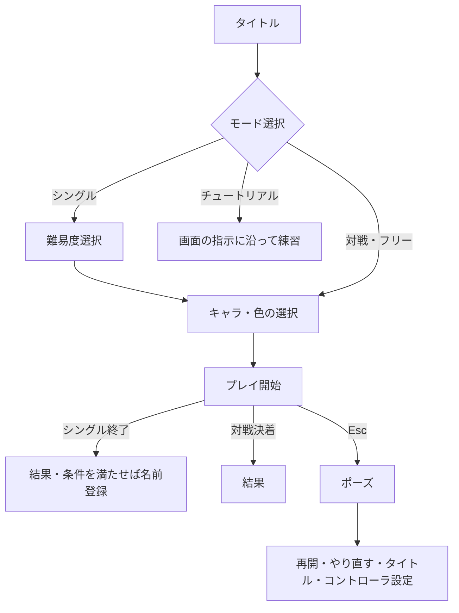

# ゲームの仕様と遊び方

## モード

| モード | 人数 | ルール |
| --- | --- | --- |
| ひとりで遊ぶ | 1人 | 体力10で100人撃破を目指す。10人ごとに自動移動し、全10区間。体力0で終了 |
| ふたりで対戦 | 2人 | 相手を場外へ押し出すと1本。3本先取。通常は1本60秒 |
| フリーモード | 1〜2人 | 時間・得点・敵なしで剣とガードを確認 |
| チュートリアル | 1人 | 向き合わせ・ガード・攻撃・反撃への防御・被弾後の防御を各5回練習 |

- シングルはイージー／ノーマルを選択。イージーは敵の攻撃準備などがゆっくり。
- シングルの被弾は通常で体力−2、ガード中の被弾で−1。ガード成功とは別の扱い。
- 対戦の同時場外・時間切れは引き分けで双方に1本。双方3本以上の同点では、時間無制限で決着をつける。
- 対戦・フリーはEscメニューで画面分割／1画面を切り替えられる。

## 操作

| やりたいこと | 操作 |
| --- | --- |
| メニューの選択 | コントローラを上下左右へ振る |
| 決定／戦闘中の防御 | ガードボタンを押す／押し続ける |
| 攻撃 | 剣を振って相手に当てる。相手のガードに平行する向きを狙う |
| 防御 | ガード中、相手の斬撃と交差する向きに剣を構える |
| 正面を合わせ直す | 正面に構えてリセットを短押し |
| ポーズ・設定 | Esc、またはリセットを0.5秒長押し |
| 前の画面へ戻る | 「もどる」を選んで決定 |

マウスでもメニューを選べる。キーボードはP1がWASD＋左Shift、P2が矢印キー＋右Shift（Shiftは決定・ガード）。攻撃を受けた直後やガードされた直後は攻撃できない時間があるため、防御に切り替える。

## 進行チャート

## ランキング・当日のタイマー

- シングルの撃破人数を難易度別に上位10件共有。同点は先着順。終了時、入賞する記録なら名前を登録できる。
- 数字キーで区間移動したプレイはランキング対象外。
- スタッフがTキーで10分タイマーをオン／オフ。ポーズややり直し中も進み、時間になると音と表示で知らせる。ゲームは強制終了しない。

実装の根拠：[進行・体力](../apps/unity/Assets/Scripts/Combat/MatchProgress.cs)、[画面遷移](../apps/unity/Assets/Scripts/GameFlowController.cs)、[練習内容](../apps/unity/Assets/Scripts/MasterController.Tutorial.cs)、[タイマー](../apps/unity/Assets/Scripts/GameFlowController.Timer.cs)。
