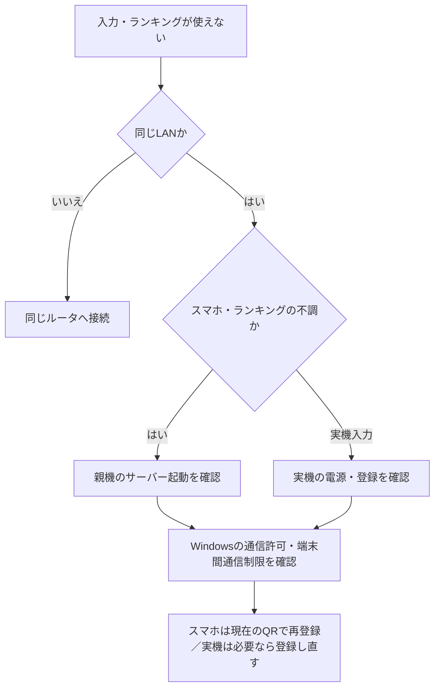

# トラブルシューティング

まずEscでポーズし、画面のP1/P2入力元と接続状態を確認する。

| 症状 | 確認・対処 |
| --- | --- |
| 実機が反応しない | PCと実機を同じLANへ接続。Esc → コントローラ → P1/P2で登録待ちにし、実機のガード＋リセットを1秒同時押し |
| 別のPC／プレイヤーを操作してしまう | 使うPCの正しいP1/P2へ登録し直す。実機の登録作業はPC1台ずつ行う |
| 剣の正面がずれる | 正面に構え、リセットを短押し |
| スマホの剣が逆向き・軸が違う | 登録時の軸調整で上下左右を確認し、軸の組み合わせ・正転／反転を修正 |
| スマホのQRを開いたのに動かない | センサー利用を許可し、ゲーム側が接続完了するまで確認。QR表示だけでは登録は完了しない |
| 実機よりスマホが優先される | スマホ接続中はスマホ優先。スマホを切断すると実機へ戻る |
| Windowsだけ接続できない | 配布フォルダーの「ゲーム起動.cmd」から起動し、初回の通信許可を完了。exeを移動したら再設定 |
| ランキングが出ない・登録できない | 親機のスコアサーバーとLAN接続を確認。対象は難易度別上位10件で、区間移動を使った記録は対象外 |
| ポーズ中も10分タイマーが減る | 当日の交代通知用として正常な動作。Tキーでオフにできる |

## 接続確認チャート

親機を再起動したら、スマホは新しいQRで開き直す。実機操作にはスマホ用サーバーは不要。

解決しない場合は、**PC名・P1/P2・実機／スマホ・症状・画面表示**を記録して担当者へ共有する。

詳細：[当日のネットワーク確認](EVENT_SERVER_SETUP.md#動かない場合)、[登録手順](CONTROLLER_PAIRING.md)、[スコアサーバー](../apps/score-server/README.md)。
